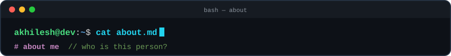
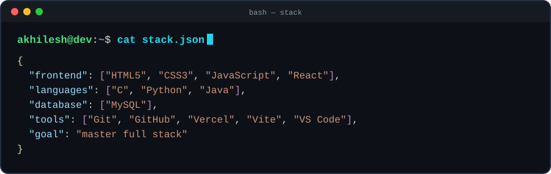
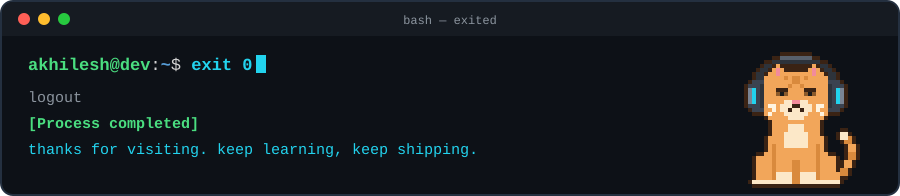

  

 

 

Hello! I'm Akhilesh, a Computer Science & Engineering Student based in Punjab, India. I specialize in front-end web engineering, core Object-Oriented Programming (OOP) in Java, and foundational data structures. My GitHub profile serves as a central hub for my academic coursework, exam preparation materials, and modern web application projects.

 

  

 

  

 

  

Auto-generated daily via GitHub Actions

 

